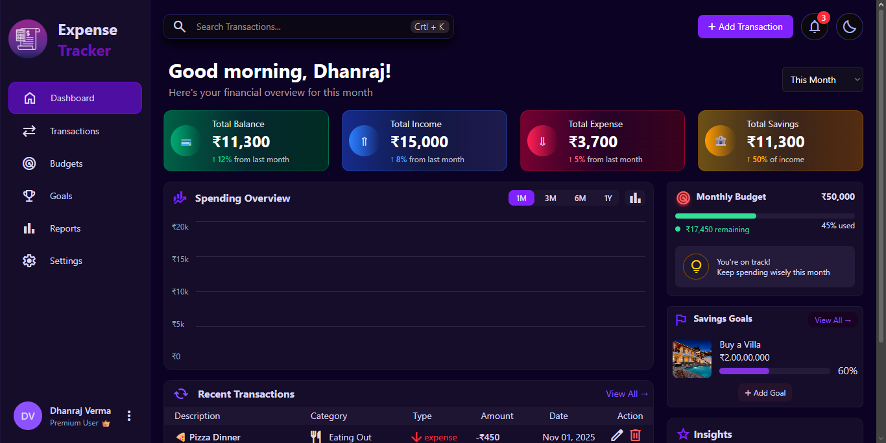
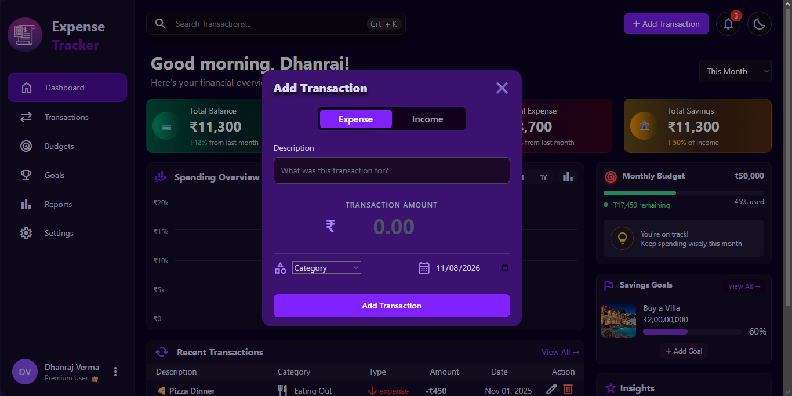

# 💰 React Expense Tracker

A modern, responsive expense tracker built with **React and Tailwind CSS** to help users manage their finances, track income and expenses, and understand their spending habits through a clean dashboard.

## 📸 Screenshots

### Dashboard


### Add Transaction


## ✨ Features

- **Dashboard Overview** – View total balance, income, expenses, and savings.
- **Transaction Management** – Add, edit, and delete transactions.
- **Income & Expense Tracking** – Organize transactions by their type.
- **Search Transactions** – Quickly find transactions by title.
- **Category Management** – Categorize transactions for better organization.
- **Date Selection** – Assign dates to individual transactions.
- **Dynamic Calculations** – Automatically calculate income, expenses, and balance.
- **Local Storage** – Save transactions in the browser so data persists after refreshing.
- **Responsive Design** – Clean dashboard layout designed for different screen sizes.
- **Interactive UI** – Modern components, icons, modals, and dashboard sections.

## 🛠️ Built With

- **React** – Component-based user interface.
- **JavaScript (ES6+)** – Application logic and functionality.
- **Tailwind CSS** – Styling and responsive layouts.
- **Vite** – Development server and build tool.
- **Material Symbols** – Interface icons.
- **Local Storage API** – Client-side data persistence.

## 🚀 Getting Started

Follow these steps to run the project locally.

### Prerequisites

- Node.js
- npm
- Git

### Installation

1. Clone the repository:

   ```bash
   git clone https://github.com/dhanverma/react-expense-tracker.git
   ```

2. Navigate to the project directory:

   ```bash
   cd react-expense-tracker
   ```

3. Install dependencies:

   ```bash
   npm install
   ```

4. Start the development server:

   ```bash
   npm run dev
   ```

5. Open the local URL displayed in your terminal.

### Production Build

To create an optimized production build:

```bash
npm run build
```

To preview the production build locally:

```bash
npm run preview
```

## 📂 Project Structure

```text
react-expense-tracker/
├── public/
├── src/
│   ├── components/
│   ├── App.jsx
│   ├── main.jsx
│   └── index.css
├── index.html
├── package.json
├── vite.config.js
└── README.md
```

*Note: The structure above is illustrative; adjust it to match the actual folders and files in your project.*

## 💡 What I Learned

While building this project, I practiced and strengthened my understanding of:

- Building reusable React components.
- Managing application state with React Hooks.
- Passing data and functions through props.
- Handling controlled forms and user input.
- Implementing CRUD operations.
- Working with JavaScript array methods such as `map()`, `filter()`, and `reduce()`.
- Persisting application data using Local Storage.
- Creating responsive interfaces with Tailwind CSS.
- Organizing a React application into reusable components.

## 🔮 Future Improvements

- Light and dark theme switching.
- Interactive spending charts and analytics.
- Monthly budgets and budget tracking.
- Savings goals.
- Advanced transaction filtering and sorting.
- Export transactions to CSV.
- Backend integration and user authentication.

## 👨‍💻 Author

**Dhanraj Verma**

- GitHub: [@dhanverma](https://github.com/dhanverma)

---

⭐ If you find this project useful, consider giving it a star!